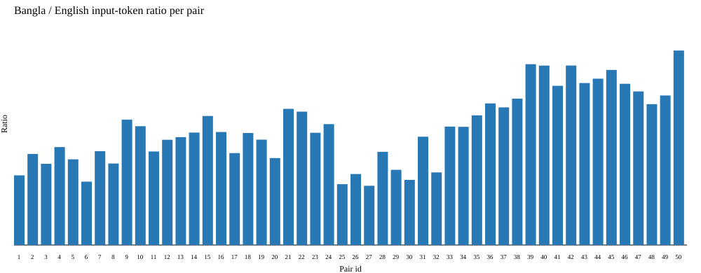

# Bangla vs English Ollama Cost Report

## Method

The manually written and reviewed dataset contains 50 aligned pairs across
questions, instructions, short explanations, arithmetic, summarisation, and
long prompts. No translation API was used. Each call used the same system
prompt (`Answer accurately, helpfully, and concisely. Follow the user's
requested format.`), model, temperature 0, seed 42, and `num_predict=128`.
Ollama's raw `prompt_eval_count` and `eval_count` are used. A baseline call with prompt `x` and the same system prompt measured the fixed
template/system overhead; the measured counts are saved in `run_metadata.json`.
The shared system prompt means this overhead is present equally in both
languages. Every call used `keep_alive=10m`, keeping the model loaded for speed; the setting was identical for both languages.

## Results

| Measure | English | Bangla | Bangla / English |
|---|---:|---:|---:|
| Input tokens (total) | 2381 | 5705 | 2.396 |
| Output tokens (total) | 2987 | 4609 | 1.543 |
| Total notional cost | $0.002149 | $0.003621 | 1.685 |
| Mean latency (seconds) | 41.902 | 52.848 | — |

Baseline (`x`) input/output counts: **32 / 19**.

Per-pair input-token ratio: mean **2.305**, median
**2.214**, minimum **1.163**, maximum
**3.820**, bootstrap 95% interval for the mean
**[2.115, 2.503]**. Output counts are reported per pair in
`comparison.csv`; costs use $0.15/M input and $0.60/M output tokens. The
`num_predict` limit was reached by 12 English and 29 Bangla
calls, so output-token and latency differences should be interpreted with that
cap in mind.

### Category gaps

| Category | Pairs | Mean input ratio |
|---|---:|---:|
| arithmetic | 8 | 1.49 |
| instruction | 8 | 2.22 |
| long | 12 | 3.28 |
| question | 8 | 1.63 |
| short_explanation | 8 | 2.21 |
| summarising | 6 | 2.59 |

The largest category mean is **long**.
The most surprising individual case is pair **50**, with ratio
**3.820**. Short prompts can be dominated by
the fixed chat-template/system overhead, so their ratio may be less extreme
than the character-level intuition; tokenization and punctuation also make
individual ratios vary. Pair 50 is notable because its Bangla input is much
longer in model tokens even though the two prompts carry the same instructions,
which is consistent with less efficient tokenization for this model.

## Quality check

The selected ten pairs are checked against the saved outputs in
`quality_check.csv`. The judgment is intentionally not inferred from token
counts.

| Pair | Bangla answer as correct/useful as English? | Notes |
|---:|---|---|
| 1 | Mostly yes | The answer identifies Tokyo correctly; the Bangla spelling is slightly nonstandard. |
| 9 | No | The answer is truncated and begins with an incorrect phrase about an electric bottle; it does not provide three useful methods. |
| 18 | No | The answer is truncated and contains incorrect or garbled reasoning instead of explaining heat conduction. |
| 25 | Yes | Both answers give the correct result, 45. |
| 33 | No | The Bangla answer is grammatical but omits the red ball and therefore loses important meaning. |
| 39 | No | The answer does not give a clear testable question, variables, or two safety reminders and is truncated. |
| 42 | No | The answer is truncated and does not clearly propose a fair presentation arrangement or give the requested reason. |
| 44 | Partial | The answer starts with the correct rationale and verification idea but is truncated before completing the requested three-step check. |
| 48 | No | The answer is truncated and gives an incorrect explanation involving the eyes rather than changing illumination and viewing angle. |
| 50 | No | The answer is incomplete and does not clearly provide three concrete actions, a justified first action, and a limitation. |

Quality summary: **Yes=1, Mostly yes=1, Partial=1, No=7**. Several
long Bangla answers hit the output limit, and the manual review therefore
shows that token cost and answer quality are separate concerns.

## Conclusion

The measured total cost ratio is **1.685** for this model,
dataset, and fixed output limit. This is an empirical result, not a universal
property of Bangla: model choice, tokenizer, prompt length, answer language,
and system/template overhead can change it. The raw per-call data and
pair-level arithmetic are included for auditability.
